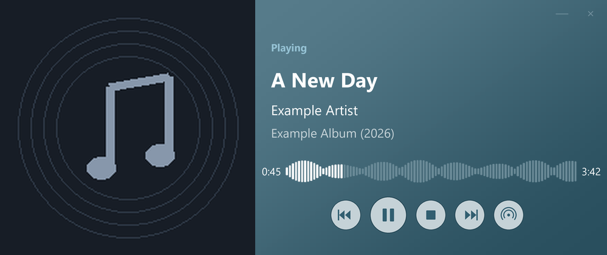

# SideTrack

A compact Windows player for JRiver Media Center.

SideTrack shows your playing track, album artwork and a waveform in a small desktop window. Its colors follow the artwork, with a soft gradient and shadow.

## Download and install

Open the [**Releases** page](https://github.com/Spiwa/SideTrack/releases) and download **SideTrack-Setup-0.1.7-preview-x64.exe**. Run the installer, then launch SideTrack from the Start menu. The core player includes Python and its dependencies; you do not need to install Python separately.

This is an **unsigned preview for Windows x64**. It has been tested locally; testing on additional clean Windows computers is still needed. JRiver Media Center is required separately. SideTrack is an independent companion, not an official JRiver product.

## First connection

1. Enable JRiver's Media Network / MCWS server.
2. Right-click SideTrack and choose **Settings**, or press **F2**.
3. Enter the server address, port and credentials. Use `localhost` when JRiver runs on this computer.
4. Choose **Test connection**, then **Save and restart**.

Press **F1** or choose **Help** for the built-in offline guide.

## Features

- Artwork-based color theme, diagonal gradient, rounded window and soft shadow.
- Previous, Play/Pause, Stop and Next controls, with tooltips and hover highlighting.
- Smooth, read-only waveform progress with consistent bar widths and spacing. Tracks without waveform metadata use a normal progress bar.
- Player size, always-on-top and optional startup with Windows.
- Manual PNG snapshots with square corners.
- Optional automatic snapshots when a new track starts. These omit elapsed time and progress highlighting, while manual snapshots retain both.
- Optional color saving to an existing JRiver custom text field. No fields are created automatically.
- Optional Artist Radio and TrackInfo Last.fm helper integrations.

## Optional requirements

The `waveform` JRiver field must already contain semicolon-separated amplitude samples to display a waveform. SideTrack does not generate waveform data from audio files.

Artist Radio requires Perl, MCUtils and the `smartlistartistquery` / `smartlistartistpath` fields. The TrackInfo helper requires a separate Python installation and the helper's own dependencies. These integrations are disabled by default and are not included in the core download. The player itself does not scrobble to Last.fm.

## Personal data

Settings and logs are stored in `%APPDATA%\SideTrack`. Passwords are encrypted for the Windows user account. Do not upload personal settings, logs or old script backups. The release contains no personal credentials or integration paths. The installer preserves existing preferences, and uninstall leaves user settings and snapshots intact.

## Feedback

For bugs, describe your Windows and JRiver versions, the steps to reproduce. Remove credentials, private paths and personal listening information before sharing logs.

## License

SideTrack is freeware, not open source. You may download, install and use it
without charge for personal or commercial purposes. Modification, redistribution
and sale require permission, subject to applicable law. Share the official
download link instead of copies. See [LICENSE.txt](LICENSE.txt) for the full terms.

Third-party components retain their own licenses; see
[third-party notices](docs/THIRD-PARTY-NOTICES.txt). This repository contains
downloads and documentation; the application source is maintained privately.
